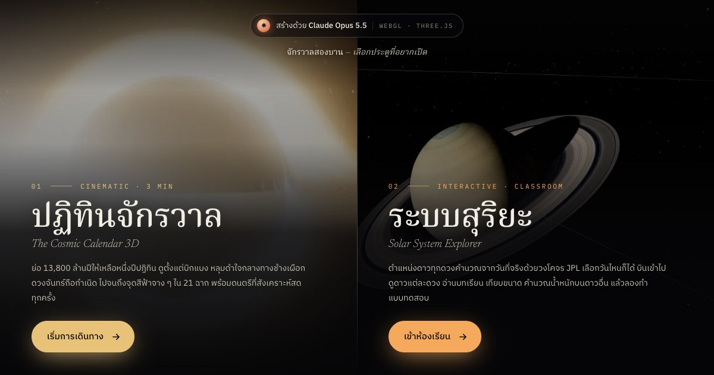
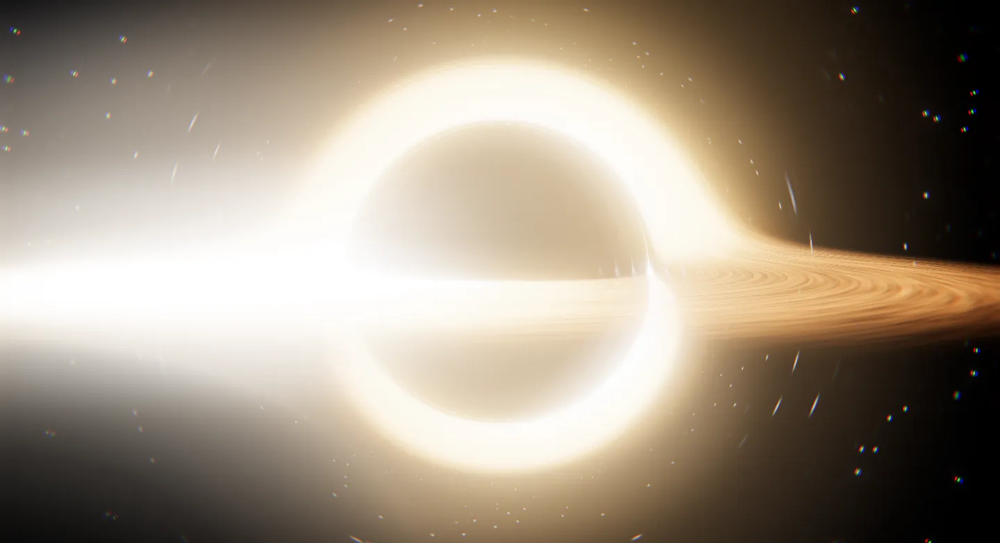
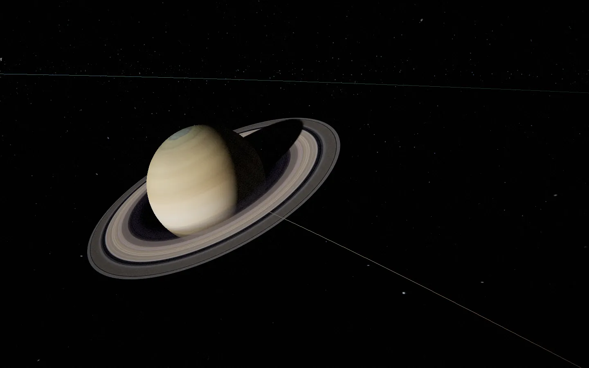

# จักรวาลสองบาน · Cosmic Opus

สองโปรเจกต์อวกาศ 3D ที่เปิดเล่นได้ในเบราว์เซอร์ เขียนด้วย **Claude Opus 5.5** แจกฟรีให้เอาไปศึกษา ดัดแปลง หรือใช้สอนได้เลย

**ลองเล่น:** https://cosmic-opus.pages.dev



| | |
|---|---|
|  |  |
| **ปฏิทินจักรวาล** · `cosmic.html` | **ระบบสุริยะ** · `solar.html` |

## ในนี้มีอะไร

**ปฏิทินจักรวาล (The Cosmic Calendar 3D)**
ย่อ 13,800 ล้านปีให้เหลือหนึ่งปีปฏิทิน เล่าเป็นภาพยนตร์ 23 ฉาก ยาวราว 4 นาทีครึ่ง ตั้งแต่บิกแบง หลุมดำ Sagittarius A* (ray-marched ใน shader) ดวงจันทร์ถือกำเนิด ไปจนถึง Pale Blue Dot มีคำบรรยายไทย/อังกฤษ และดนตรีที่สังเคราะห์สดด้วย Web Audio (ไม่มีไฟล์เสียงสักไฟล์)

- `cc19-core.js` renderer, post-processing, shader ของดวงอาทิตย์ โลก ดาวเคราะห์
- `cc19-cosmos.js` ฉากระดับจักรวาล (บิกแบง → ระบบสุริยะ)
- `cc19-earth.js` ฉากของโลกและมนุษย์ (ดวงจันทร์ → ยูริ กาการิน → จุดสีฟ้าจาง ๆ) ส่วนฉากยานวอยเอเจอร์อยู่ใน `cc19-cosmos.js`
- `cc19-app.js` ไทม์ไลน์ คำบรรยาย แถบปฏิทิน การควบคุม
- `cosmic-audio.js` เครื่องดนตรี generative

คีย์ลัด: `Space` เล่น/หยุด · `[` `]` เปลี่ยนบท · `L` ภาษา · `M` เสียง · `H` ซ่อน UI · `F` เต็มจอ

**ระบบสุริยะ (Solar System Explorer)**
ห้องเรียนอวกาศแบบโต้ตอบ ตำแหน่งดาวคำนวณจากวันที่จริงด้วยองค์ประกอบวงโคจร J2000 ของ JPL มีทัวร์นำชม บทเรียนรายดาว (โครงสร้าง บรรยากาศ บริวาร ภารกิจ) ที่กดฟังเสียงบรรยายได้ทีละแท็บ บทเรียนข้างขึ้นข้างแรม อุปราคา และฤดูกาล เครื่องมือเทียบขนาด คำนวณน้ำหนัก/อายุบนดาวอื่น เวลาเดินทาง แสงเดินทาง ไทม์ไลน์ และแบบทดสอบ

- `solar-data.js` ข้อมูลดาว + ฟิสิกส์วงโคจร (Kepler)
- `solar-3d.js` ฉาก three.js, shader ดาว, แถบดาวเคราะห์น้อย/ไคเปอร์
- `solar-tools-v2.js` เครื่องมือประกอบการสอน
- `solar-app-v2.js` UI, ทัวร์, ตัวเล่นบทเรียน, คีย์ลัด
- `solar-lessons.js` ข้อความที่ผู้บรรยายพูดในแต่ละแท็บบทเรียน และทัวร์ภาษาอังกฤษ
- `moon-lesson.js` ภาพข้างขึ้นข้างแรม อุปราคา และฤดูกาล วาดบน canvas ใช้ร่วมกันทั้งหน้าเว็บและในแว่น VR (เฟสของดวงจันทร์คำนวณจากลองจิจูดดวงอาทิตย์และดวงจันทร์)

คีย์ลัด: `1–8` ดาวเคราะห์ · `9` ดวงจันทร์ · `0` ดวงอาทิตย์ · `T` ทัวร์ · `E` ทัวร์ภาษาไทย/อังกฤษ · `L` แสงเดินทาง · `O` ภาพรวม · `M` เสียง · `?` คู่มือ

## เสียงบรรยายและโหมด VR

**เสียงบรรยาย** ปฏิทินจักรวาลมีเสียงบรรยายทุกฉาก (กด `N` เปิด/ปิด) ฉากที่สั้นกว่าเสียงบรรยายจะเล่นช้าลงให้พอดี ไม่ตัดเสียง ทัวร์ระบบสุริยะมีเสียงบรรยายทุกจุด ปุ่ม "ฟังบทเรียน" ในแผงข้อมูลอ่านบทเรียนของดาวดวงนั้นทีละแท็บและเปลี่ยนแท็บตามเสียง บทเรียนดวงจันทร์และฤดูกาลก็มีเสียงบรรยายทุกหัวข้อ
- ภาษาไทย: ElevenLabs Eleven v4 (เสียง Jessica)
- ภาษาอังกฤษ: Kokoro (เสียง af_heart) ใช้กับทัวร์ระบบสุริยะ (กด `E` หรือปุ่ม EN บนการ์ดทัวร์) และปฏิทินจักรวาลเมื่อตั้งภาษาเป็น EN
- เสียงประกอบ: ElevenLabs Sound Effects v2 ทั้งหมดเรียกผ่าน fal.ai

**โหมด VR (WebXR)** เปิดเว็บในเบราว์เซอร์ของแว่น เช่น Meta Quest 2 ขึ้นไป แล้วกดปุ่ม VR (ต้องเปิดผ่าน HTTPS)
- ระบบสุริยะ: ระบบสุริยะทั้งระบบย่อลงมาเป็นโมเดลบนโต๊ะตรงหน้า ชี้ดาวแล้วกดไกปืนเพื่อบินไปดูใกล้ ๆ ในขนาดใหญ่เท่าตัวจริงในห้อง มีแผงเมนูระดับเอว การ์ดข้อมูล และทัวร์นำชมพร้อมเสียงบรรยาย (คันโยกซ้าย/ขวา = ดาวถัดไป, A = ทัวร์, B = ถอยออกหนึ่งขั้น)
  - การ์ดของแต่ละดาวมีแท็บบทเรียนพร้อมเสียงบรรยาย (คันโยกขึ้น/ลง = เปลี่ยนแท็บ) และแบบทดสอบที่ตอบด้วยการชี้แล้วกดไกปืน
  - เทียบขนาด: ดาวทุกดวงเรียงเป็นแถวตามขนาดจริงเมื่อเทียบกัน โลกกว้าง 50 ซม. ดาวพฤหัสบดี 5.5 เมตร ดวงอาทิตย์ 54.6 เมตรตั้งอยู่ข้างหลัง โยกคันโยกเพื่อเดินไปตามแถว
  - ดวงจันทร์: กระดานบทเรียนข้างขึ้นข้างแรม อุปราคา และฤดูกาล ภาพเดียวกับบนหน้าเว็บ
- ปฏิทินจักรวาล: ฉายบนจอโค้งใหญ่กลางอวกาศแบบโรงหนัง มีคำบรรยายใต้จอ (ไกปืน = เล่น/หยุด, คันโยก = เปลี่ยนบท, A = เสียงบรรยาย, ปุ่มกำ = จัดจอให้อยู่ตรงหน้า) กล้องในหนังเคลื่อนที่ตลอด ถ้าพาคนดูเคลื่อนตามในแว่นจะเวียนหัว จึงฉายเป็นจอแทน

- `vr-kit.js` ตัวช่วย WebXR ร่วม (เริ่ม session, แผงข้อความไทยบน canvas, ลำแสงจากจอย, จอมืดตอนเปลี่ยนจุด)
- `audio-kit.js` Web Audio ร่วม (เสียงบรรยาย, เสียงประกอบ, เสียงพื้นหลังที่วนต่อเนื่องแบบ crossfade)
- `solar-vr.js` `solar-audio.js` · `cc-vr.js` `cc-vo.js`

## รันเอง

ไม่มี build ไม่ต้อง `npm install` เป็นไฟล์ static ล้วน แต่ต้องเปิดผ่าน web server (เปิดไฟล์ตรง ๆ แบบ `file://` แล้ว ES modules กับ texture จะโหลดไม่ขึ้น)

```bash
git clone https://github.com/claude-skills-kit/cosmic-opus.git
cd cosmic-opus
python3 -m http.server 8000
# เปิด http://localhost:8000
```

three.js r160 โหลดจาก unpkg ผ่าน import map ต้องต่อเน็ตตอนเปิด

**ขึ้นเว็บ:** อัปทั้งโฟลเดอร์ขึ้นโฮสต์ static ไหนก็ได้ เช่น Cloudflare Pages (`npx wrangler pages deploy . --project-name <ชื่อ>`), GitHub Pages, Netlify, Vercel

## ต้องใช้อะไร

เบราว์เซอร์ที่รองรับ WebGL2 (Chrome, Edge, Safari, Firefox รุ่นใหม่) ฉากหลุมดำหนักพอสมควร บนมือถือรุ่นเก่าอาจกระตุก

## สัญญาอนุญาต

- **โค้ด** (HTML/CSS/JS): MIT — ดู [LICENSE](LICENSE)
- **เสียง** ใน `audio/`: สร้างด้วย ElevenLabs (Eleven v4 + Sound Effects v2) ผ่าน fal.ai ดู [audio/CREDITS.md](audio/CREDITS.md)
- **ภาพพื้นผิวดาว** ใน `textures/`: ไม่อยู่ใต้ MIT เป็นของ Solar System Scope (CC BY 4.0, อ้างอิงข้อมูล NASA) และ three.js (MIT) — ดู [textures/CREDITS.md](textures/CREDITS.md) ถ้าเอาไปใช้ต่อ ให้คงเครดิตไว้

---

### English

Two browser-based 3D space pieces, written with **Claude Opus 5.5** and given away free.

- **The Cosmic Calendar 3D** (`cosmic.html`): 13.8 billion years squeezed into one calendar year. A 23-scene, ~4.5-minute film from the Big Bang to the Pale Blue Dot, with Thai/English captions and a generative Web Audio score.
- **Solar System Explorer** (`solar.html`): an interactive classroom. Planet positions for any date come from JPL J2000 orbital elements. Includes a guided tour, narrated per-planet lessons, a moon phases / eclipses / seasons lesson, size comparisons, weight, age and travel-time calculators, a light-travel visualisation, a timeline and quizzes.

Both pages have narration (Thai: ElevenLabs Eleven v4; English: Kokoro; both generated through fal.ai) and recorded sound effects, and a WebXR mode for headsets such as Meta Quest 2: the Solar System becomes a tabletop model you can fly into, with lessons and quizzes on a card, a true-to-scale size line-up and a moon-and-seasons board, and the Cosmic Calendar plays on a curved cinema screen.

It's plain static files with no build step. Serve the folder (`python3 -m http.server`) and open it in a browser; `file://` won't load the modules. Code is MIT. Textures are CC BY 4.0 (Solar System Scope) or MIT (three.js), and their credits must travel with them.

Made by [Quiet Kit Co.](https://github.com/claude-skills-kit)
